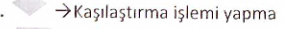
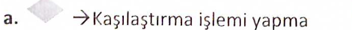

# FAZ 3F — 11 Ekim 2026

## 11 Ekim 2026 güncellemesi

Bu rapor FAZ 3F sırasında doğrulanan ölçümleri kaydeder. Sonraki kullanıcı onayıyla radio grupları iki checkbox'a, soru metni ve ayrı görünüm tek editöre dönüştürüldü; [güncel düzenleyici raporu](editor-simplification.md). Bu değişiklik eski gerçek PDF/OCR ölçümlerini yeni tarayıcı testi olarak sunmaz.

Gösterim seçimi, öğrenci verisi, sıra, kırpma ve hibrit tanılama değiştirildi. Yeni bağımlılık eklenmedi. OCR tur+eng / OEM1 / PSM11 / 144 DPI, 3C numara-sütun kabul kuralları ve üretim kırmızı eşiği korundu. 250 DPI yalnız şekilli şık görsellerinin render işleminde kullanılır; OCR girdisini değiştirmez. Otomatik metin düzeltmesi uygulanmaz.

## 1. Soru ve şık gösterimi

**Bulgu:** Eski `displayMode` ve görsel varlığı, metin yerine otomatik M3 gösterimine geçebiliyordu. Tek seçim soru gövdesiyle şıkları bağımsız yönetemiyordu.

**Kanıt:** `tests/phase3f-regression.mjs` eski/yeni kayıtların metin varsayılanını, dört seçimi, eksik veriyi ve tam görselin kullanılma şartını sınar. `tests/quiz-regression.mjs` kaydetme/öğrenci API/varlık yetkisini sınar.

**Değişiklik:** Her soruda yerel HTML radio grupları `questionDisplay` ve `optionDisplay` kullanılır; alan yoksa ikisi de metindir. Soru ve şık için ayrı “Tüm sorulara uygula” vardır. Alanlar JSON'da saklanır. Öğretmen önizlemesi aynı `studentExam` projeksiyonunu kullanır. Metin boşsa görsele geçilmez; uyarı ve yayın engeli üretilir. Güvenli görsel veya tamamlanmış sınır/geometri yoksa görüntü seçimi kapalıdır. Şık görüntüleri ayrı harf rozetiyle, soru görüntüsü gövdeyle gösterilir. Tam görüntü ancak iki seçim görüntü ve `imageIncludesOptions=true` iken A–E düğmeleriyle kullanılır. Radio hedefleri en az 48 px'dir.

**Sonuç:** Varsayılan, dört seçim, JSON ve eksik veride engelleme otomatik testlerle doğrulandı. Tam görüntüye geçmek için iki radio seçimi gerektiren kayıtların kilitlenmesi de düzeltildi. Gerçek klavye/dokunma testi **doğrulanamadı**.

## 2. Responsive önizleme ve kayıp şıklar

**Bulgu:** Görsel şık kapsayıcısındaki `flex:1` küçük görselleri büyütebiliyordu. Otomatik tam görüntü modu, bağımsız şık metinlerini gizleyebiliyordu. Boş OCR yuvasında render sorunu ile eksik veri birbirine karışıyordu.

**Kanıt:** CSS ve React testleri doğal genişliği, `max-width:100%`, `height:auto`, esnek düğmeleri ve ayrı soru/şık renderını kontrol eder. Gerçek PDF'de Soru 6 A metni boş; Soru 5 ve 21 yer tutucudur. Bunlar render ile tamamlanmış sayılmaz.

**Değişiklik:** Görseller doğal genişlikte kalır, büyükse kapsayıcıya küçülür; sabit/yüzde yükseklik verilmez. Şık kapsayıcısı büyümeye zorlanmaz, `object-fit:contain` kullanılır. Eksik seçilen veri açık mesaj üretir. Manuel gövde kırpması artık gövde önizleme kopyasını da günceller.

**Sonuç:** Kod/CSS ve dört modun render testleri geçti. Gerçek tarayıcı aracı başlatılamadı; aşağıdaki ekran görüntülerinin tamamı **doğrulanamadı**. PDF'den üretilmiş PNG'ler tarayıcı ekran görüntüsü değildir.

| Kaynak sorular | Masaüstü 1280 | Tablet 768 | Telefon 390 | Telefon 360 |
|---|---|---|---|---|
| 1, 5, 6, 7, 9, 16 | doğrulanamadı | doğrulanamadı | doğrulanamadı | doğrulanamadı |

Kaynak kırpmaları: [1](phase3f-assets/source-q1.png), [5](phase3f-assets/source-q5.png), [6](phase3f-assets/source-q6.png), [7](phase3f-assets/source-q7.png), [9](phase3f-assets/source-q9.png), [16](phase3f-assets/source-q16.png).

## 3. Cevap sızıntısı

### Ölçüm

**Bulgu:** Kırmızı piksel sıfır olsa da silinmiş harf/nokta doğru cevabı ayırt ettirebiliyor.

**Kanıt:** `scripts/measure-leakage.mjs` yalnız yerel betikte sayfa 12 anahtarıyla marker koyu piksel oranı, silinen kırmızı alan, gövde koyu piksel kaybı ve diğer dört şıkla farkı ölçer. [Ölçüm JSON'u](phase3f-assets/leakage-metrics.json) şık başına sonuçları içerir. Aşağıdaki oranlar yüzde, sıralama A/B/C/D/E; silinen alan eşikçe kırmızı bulunan marker alanıdır.

| Soru | Kırmızı temizleme sonrası marker koyuluğu (%) | Silinen marker alanı (%) | Temizlemede ayrışma | Eşit maskeden sonra |
|---|---|---|---|---|
| 1 | 10.181 / 10.973 / 9.050 / 12.217 / 2.094 | 0.113 / 0 / 0 / 0 / 6.061 | Evet, z=-7.37 | İşaretlenmedi; z=-1.67 |
| 5 | Geometri eksik | Geometri eksik | doğrulanamadı | doğrulanamadı |
| 6 | A eksik; B 11.810 / C 6.878 / D 11.111 / E 5.238 | A eksik; B 0 / C 0 / D 0.529 / E 0.238 | doğrulanamadı | doğrulanamadı |
| 9 | 4.462 / 5.882 / 1.634 / 6.373 / 2.566 | 0 / 0 / 9.259 / 0 / 0 | Evet, z=-2.15 | Fark 0; işaretlenmedi |
| 18 | 11.429 / 12.487 / 9.011 / 10.659 / 6.341 | 0 / 0 / 0 / 0 / 0 | İşaretlenmedi; z=-0.52 | Fark 0 |
| 19 | 8.678 / 11.212 / 8.874 / 10.031 / 3.926 | 0.207 / 0 / 0 / 0 / 0 | İşaretlenmedi; z=1.43 | Fark 0 |
| 21 | Geometri eksik | Geometri eksik | doğrulanamadı | doğrulanamadı |
| 24 | 10.549 / 11.958 / 9.029 / 11.314 / 0.914 | 0.330 / 0 / 0 / 0.229 / 0 | İşaretlenmedi; z=0.75 | Fark 0 |

Beş şık tek sorudan alınan betimleyici örneklerdir. |z|≥2 keşif amaçlı işaret, doğrulanmış istatistiksel sınıflandırıcı veya anlamlılık testi değildir. Soru 1'de maskelenen alan ölçümünde kodlama/kenar piksellerinden küçük koyuluk kalır (A–E: %0.114 / 0.220 / 0.110 / 0.330 / 0.043); “tümü sıfır” denmez. Ölçülen beş tam sorunun gövde kaybı karşılaştırmasında ayrışma işaretlenmedi; gövde sızıntısının yokluğu **doğrulanamadı**.

### Maskeleme, risk ve ağ verisi

**Değişiklik:** Kırmızıyı gizlemek için şık gövdesi içerik sınırına göre daraltılmaz. Tam hücre korunur, soru içindeki tüm şıklarda aynı marker genişliği maskelenir ve uygulama harf rozeti çizer. Gövdede kırmızı varsa `KALEM_IZI_RISKI` uyarısı/“İşaretsiz kopya önerilir” ve yayın öncesi açık onay korunur. Kenarları kesik görünen şıklar güvenli öğrenci görselinden çıkarılır. Manuel şık kırpması eski marker koordinatını kullanır; koordinat bilinmiyorsa görüntü güvenli kabul edilmez.

**Kanıt:** Sabit hücre boyutu, marker maskesi, manuel yeniden kırpma, risk onayı ve eksik görsel testleri geçti. 174 iç güvenli görselde mevcut eşikçe kırmızı oranı 0. Öğrenci projeksiyonu `correct`, PDF anahtarı, cevap önerisi, provenance, risk/tanılama ve orijinal görüntüleri çıkarır; seçilmeyen varlıklar da gönderilmez. Puanlama yanıtındaki şık doğru indeksleri de çıkarıldı. API testlerinde yetkisiz orijinal/seçilmemiş varlık erişimi engellendi. Gerçek PDF'den öğretmence tamamlanmış test taslağıyla API save/get sınandı; bu içerik otomatik düzeltilmiş OCR değildir.

**Sonuç:** Ağ sözleşmesi/varlık erişimi API seviyesinde doğrulandı; gerçek tarayıcı ağ kaydı **doğrulanamadı**. Sıfır kırmızı tam sızıntı yokluğu değildir. Risk tespiti tarama/JPEG gürültüsüne karşı temkinlidir; sınıflandırma doğruluğu **doğrulanamadı**.

Eski örtüşme 18/23=%78.26; yeni 17/24=%70.83. İkisinde de ≥30 piksellik güçlü kırmızı bileşen filtresi var; eski dar/yer yer yaklaşık kutular ile yeni tam hücre geometrisi farklı. Bu fark maskelemenin tek başına iyileştirme kanıtı değildir. Yeni ilk 11 sorudaki ölçülebilen 8 işaretin 8'i anahtarla örtüşür; kaynağın işaretli olması riski sürer.

## 4. Sıra ve Soru 6/7 sınırı

**Bulgu:** AI/yer tutucu eklemeleri sona eklenince Soru 7 gibi kayıtlar numarasından uzaklaşabiliyordu. Komşu soru gövdesine yaklaşan kırpmalar vardı.

**Kanıt:** Taslak güncelleme, yükleme/kaydetme, AI önerisi uygulama, hariç kaydı geri alma ve öğrenci projeksiyonu sıralama testleri geçti. Gerçek PDF raster SHA256 eşleşmesiyle OCR kayıtları güncel kodda tekrar yürütüldü; sahte OCR başarı sayılmaz.

**Değişiklik:** Bölüm sırası içinde soru numarasıyla sıralanır. Bir sonraki sorunun gövdesinden önce biten sınır uygulanır, geometrik komşu çakışması `NEIGHBOR_OVERLAP` uyarısı/yayın engeli üretir. Tüm içerik metinleri önceki geçerli tekrar yürütmeyle aynı kaldı; otomatik düzeltme yapılmadı.

**Sonuç:** Güncel açık koşum 48 okunan + 2 yer tutucu (5,21), kapalı koşum 47 + 3 yer tutucu (5,21,23); ikisi de 50 kayıt. Yeni gerçek Tesseract açık koşumu da 48+2 üretti. Bağımsız gerçek 49 sorulu OCR koşumu **doğrulanamadı**. Gerçek 50 kayıttan 23 çıkarılarak oluşturulan 49 kayıtlı taslak regresyonu ayrı, simüle edilmiş senaryodur.

| Koşum | Kayıt | Soru 6 sıra | Soru 7 sıra | Kanıt türü |
|---|---:|---:|---:|---|
| Hedefli OCR açık | 50 | 6 | 7 | Gerçek PDF + gerçek OCR kaydı tekrarı |
| Hedefli OCR kapalı | 50 | 6 | 7 | Gerçek PDF + gerçek OCR kaydı tekrarı |
| Açık, 23 çıkarılmış taslak | 49 | 6 | 7 | Taslak regresyonu; bağımsız OCR değil |
| Kapalı, 23 çıkarılmış taslak | 49 | 6 | 7 | Taslak regresyonu; bağımsız OCR değil |

Sayfa 3 sağ sütun: Soru 6 x=.5137421875, y=.3233863636, w=.4612578125, h=.1964261364; alt sınır .5198125. Soru 7 x=.5137421875, y=.5336136364, w=.4612578125, h=.1680170455. İstenen koordinatlar korundu.

Soru 6 şıkları: A **boş/çözülemedi**, B Akış diyagramı, C İş diyagramı, D Programlama Dili, E Veri tabanı. Soru 7: 3 / 4 / 9 / 12 / 15; sıra çıkarımı uyarısı öğretmen incelemesinde kalır.

Görseller (PDF kırpması, tarayıcı değil): [açık 50 / 6](phase3f-assets/open-50-q6.png), [7](phase3f-assets/open-50-q7.png); [kapalı 50 / 6](phase3f-assets/closed-50-q6.png), [7](phase3f-assets/closed-50-q7.png); [açık 49 taslak / 6](phase3f-assets/open-49-q6.png), [7](phase3f-assets/open-49-q7.png); [kapalı 49 taslak / 6](phase3f-assets/closed-49-q6.png), [7](phase3f-assets/closed-49-q7.png).

## 5. Kırpma bantları

**Bulgu:** Yer tutucu 5'in eski alt sınırı .332, Soru 6'nın başlangıcı .323386 olduğundan çakışıyordu. Önceki .94 alt sınırı altlık bandına izin veriyordu.

**Kanıt:** Yer tutucu/üst-alt bant/komşu sınırı testleri ve kaynak koordinatları.

**Değişiklik:** Yer tutucu da sütun sınırlarına, .92 altlık sınırına ve sonraki kabul edilmiş gövde başlangıcına bağlandı. Soru 5'in altı .322386'ya çekildi. Geometrik üst bilgi, altlık ve komşu uyarıları eklendi. Mevcut sütun çizgisi hariç tutan sınırlar korundu.

**Sonuç:** Üretilen kaynak kırpmalarında ve sentetik bant kontrollerinde doğrulandı. Her PDF için başlık metni/çizgi semantik tanıması veya keyfî manuel kırpmanın tüm bantlarının otomatik doğrulanması **doğrulanamadı**; mevcut denetim ana soru/yer tutucu kutusuna dayanır.

## 6. Soru 9 şekilli şıklar

**Bulgu:** Eski 144 DPI dar şık kırpmalarında şekiller küçük ve bazı üst kenarlar kesikti.

**Kanıt:** Öncesi/sonrası gerçek PDF görüntüleri aşağıdadır; otomatik kenar testi A/B/C/D'yi hâlâ eksik kabul eder.

**Değişiklik:** Hedef bölge 250 DPI render edilir, hücre kenar boşlukları artırılır; içerik için kırpma daraltılmaz. Hâlâ kesik şıklar güvenli öğrenci kopyasına konmaz ve Soru 9 görüntü şıkkı/tam görsel seçimi kapalıdır.

| Şık | Önce px | Sonra px | Sonuç |
|---|---|---|---|
| A | 284×29 | 574×49 | Eksik; kapalı |
| B | 244×29 | 572×49 | Eksik; kapalı |
| C | 215×27 | 583×47 | Eksik; kapalı |
| D | 238×30 | 574×50 | Eksik; kapalı |
| E | 200×28 | 574×80 | Kenar testi geçer; diğer şıklar nedeniyle soru modu kapalı |

Önce A:

Sonra A (öğretmen aday kırpması; öğrenciye verilmez):

Diğerleri: [B önce](phase3f-assets/q9-before-1.png)/[sonra](phase3f-assets/q9-after-1.png), [C önce](phase3f-assets/q9-before-2.png)/[sonra](phase3f-assets/q9-after-2.png), [D önce](phase3f-assets/q9-before-3.png)/[sonra](phase3f-assets/q9-after-3.png), [E önce](phase3f-assets/q9-before-4.png)/[sonra](phase3f-assets/q9-after-4.png).

**Sonuç:** Daha yüksek render ve güvenli engelleme doğrulandı; “bütün şekiller düzeldi” denmez. İnsan tarafından tüm şıkların okunabilirlik onayı **doğrulanamadı**.

## 7. Hibrit çağrı tanılaması

**Bulgu:** Eski sayfa 3 EXPECTED_COUNT çağrısında Soru 5 için geçmiş ham cevap tutulmadığından önerinin niçin çıkmadığı kesin belirlenemiyor.

**Kanıt:** Yeni kontrollü testte beklenen 5 yerine 4/6 dönmesi `MISSING_EXPECTED_QUESTION` üretir; boş/hatalı/no-change/proposal kararları ayrı sınanır. Bu test geçmiş gerçek AI yanıtı değildir.

**Değişiklik:** Hedef türü/sayfa/kutu/uyarılar, yanıtın anahtar adları ve içerik türü, parser kararı, dönen soru sayıları, istenen/dönen/eksik numaralar, süre, token kullanımı ve karar kodu tanılamaya eklenir. API anahtarı, ham görsel, soru metni ve anahtar bu hibrit çağrı kaydına eklenmez. Veri sunan sağlayıcının token alanı yoksa uydurulmaz. Bütün AI onarımları öğretmenin “Öneriyi uygula” kararıyla uygulanır.

**Sonuç:** Yeni kayıt ve kontrollü eksik-5 senaryosu doğrulandı. Geçmiş gerçek çağrının görsel sınırları/ham yapısı/token/süresi ve Soru 5'in önerisiz kalmasının kesin nedeni **doğrulanamadı**. Yeni canlı sağlayıcı çağrısı da **doğrulanamadı**.

## 8. Doğrulama ve sınırlar

**Bulgu:** Bir testin geçmesi gerçek mobil veya OOM doğrulaması değildir. Windows test sunucusunun signal ile kapanmasında `exitCode=null` yanlış yorumlanıp klasör temizliği hata verebiliyordu.

**Değişiklik:** Test sunucusu hem exitCode hem signalCode kontrol eder, close olayını bekler; asıl başlangıç hatası temizleme hatasıyla örtülmez. Kaynak ortak değişiklikleri `sites-source` kopyasına işlendi.

**Kanıt / sonuç:**

- README test paketi: **169 test, 160 geçti, 9 atlandı, 0 hata**. FAZ 3F'nin 16 yeni testi geçti. Mevcut fixture betikleri de hata vermeden tamamlandı. Atlanan referans kontrolleri başarı sayılmaz.
- TypeScript `tsc --noEmit`: çıkış 0.
- Güncel üretim build: çıkış 0; standalone bağımlılık bağlantıları tamamlandı. Son build üzerindeki gerçek HTTP/SQLite ve taşınabilir paketleme: **9/9 geçti**. Giriş/yetki, paylaşım/varlık, puanlama, yeniden başlatma, yedekleme ve cookie sınandı. Uygulama `http://127.0.0.1:3000` adresinde yeniden başlatıldı.
- Gerçek PDF API testi: 1/1; dört gösterim, orijinal/seçilmemiş varlık erişimi ve anahtarsız veri için ek API regresyonu geçti. Bunlar gerçek tarayıcı kaydı değildir.
- Yeni gerçek OCR açık koşumu: 13 çağrı; OCR 63.513 sn, toplam 161.475 sn, örneklenen süreç RSS tepe 435.35 MiB. Eşzamanlı işler nedeniyle bu değer karşılaştırmalı performans ölçütü değildir. Hedefli OCR'da Tesseract kutu uyarıları görüldü; sonuç yine 48+2. Tek koşum OOM dayanıklılığı kanıtı değildir.
- Gerçek 49 OCR, gerçek tarayıcı/klavye/mobil, responsive ekran görüntüleri, canlı AI ve gerçek OOM: **doğrulanamadı**.
- Dijital Tapu A referans dosyası bulunmadı: 50/50 gerçek regresyon **doğrulanamadı**.

Çalıştırma: `node tools/pnpm/dist/pnpm.mjs test`, `node tools/pnpm/dist/pnpm.mjs typecheck`, `node tools/pnpm/dist/pnpm.mjs build`, ardından `node tools/pnpm/dist/pnpm.mjs test:server`. Yerel sızıntı ölçümü: `node scripts/measure-leakage.mjs kaynak.pdf ogretmen-taslagi.json sonuc.json`. Ölçüm anahtarını uygulama veya öğrenci yanıtına eklemeyin.

Eksik soru/şık metinleri ve kapalı riskli görüntüler öğretmen kararı bekler. Bunlar sessizce tamamlanmış veya yayınlanabilir sayılmaz.

DUR
